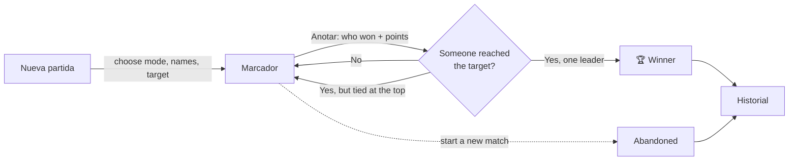
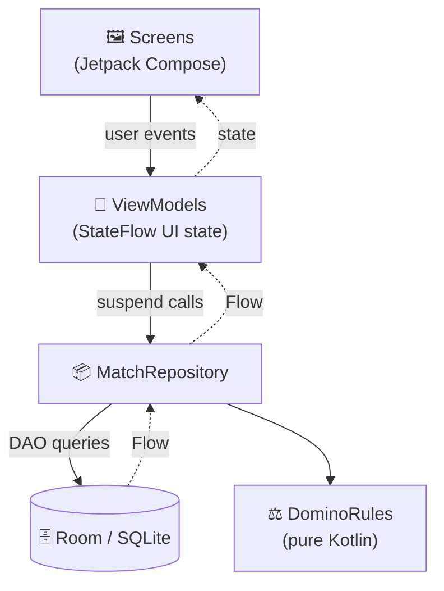
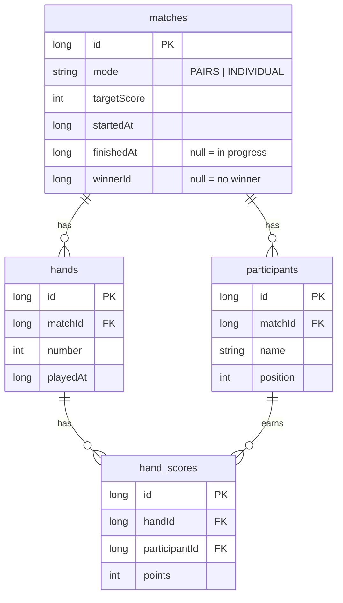

<div align="center">

# 🁫 Capicúa

**A domino score tracker for Android.**
Set a target score, log the points of every hand, and let the app call the winner.


</div>

---

## 📖 Table of contents

- [Features](#-features)
- [How a match works](#-how-a-match-works)
- [Screens](#-screens)
- [Winner rules](#-winner-rules)
- [Design](#-design)
- [Architecture](#-architecture)
- [Database](#-database)
- [Tech stack](#-tech-stack)
- [Getting started](#-getting-started)
- [Testing](#-testing)
- [Project structure](#-project-structure)

---

## ✨ Features

| | |
|---|---|
| 👥 **Two game modes** | **Pairs** (2 teams) or **Individual** (2 to 4 players), with custom names. |
| 🎯 **Configurable target** | Quick presets of **100, 150, 200 or 250** points (200 by default), or any custom value. |
| ✍️ **Fast scoring** | One tap on *Anotar* next to whoever won the hand, type the points, done. |
| ✏️ **Fix mistakes** | Every hand can be edited or deleted; totals and the winner are recalculated instantly. |
| 🏆 **Automatic winner** | When someone reaches the target, a winner banner appears. Ties at the top keep the match going. |
| ⏯️ **Resume anytime** | The match in progress is saved continuously; a *Continuar* card brings you right back. |
| 🗂️ **Match history** | Every match ever played, with its status, scores, target and number of hands. |
| 📴 **100 % offline** | Everything lives in a local database on the device. No accounts, no internet, no tracking. |
| 🌗 **Light & dark themes** | A custom "Caribbean" palette that follows the system theme. |
| 🔄 **Survives rotation** | State is kept across configuration changes and process restarts. |

> The interface is in Spanish; the code and documentation are in English.

---

## 🎲 How a match works



1. **Create the match**: pick *Parejas* or *Individual*, name the teams/players and choose the target score.
2. **Play hands**: after each hand, tap *Anotar* on the winner and enter the points they earned.
3. **Watch the race**: every participant shows their total and how many points they still need (*Faltan 35*).
4. **Win**: as soon as one participant reaches the target with the highest total, the match ends and the winner is celebrated.

A match can be in one of three states:

| State | Meaning | Can it change? |
|---|---|---|
| 🟢 **In progress** | Being played right now (only one at a time). | Yes |
| 🏆 **Finished** | Someone won. | Yes — editing a hand may "un-finish" it if the winner no longer qualifies. |
| ⚪ **Abandoned** | A new match was started before this one ended. | No — read-only. |

---

## 📱 Screens

### 🆕 Nueva partida (New match)
- Segmented choice between **Parejas** (2 teams) and **Individual** (2–4 players).
- Name fields with sensible placeholders (*Equipo 1*, *Jugador 2*…); add or remove players in individual mode.
- Target score chips (100 / 150 / 200 / 250 / *Otro*) with validation for custom values.
- If a match is already in progress, a **Partida en curso** card lets you continue it, and warns that starting a new one will abandon it.
- Shortcut to the **history**.

### 🧮 Marcador (Scoreboard)
- Large, tabular-digit totals for each participant, easy to read from across the table.
- Points remaining to reach the target for each participant.
- An *Anotar* button per participant opens a **bottom sheet** to enter the hand.
- List of every hand played (*Mano 1, Mano 2…*); tap one to **edit** or **delete** it.
- **Winner banner** in sun yellow — *¡Victoria para …!* — or a notice when there's a tie at the target.
- Abandoned matches are shown read-only with an explanatory notice.

### 🗂️ Historial (History)
- Every match: the one in progress first, then the most recently finished.
- Each card shows participants, scores, status (*En curso*, *Abandonada*, or a 🏆 next to the winner), target and number of hands.
- Tap a match to open its scoreboard; delete it with a confirmation dialog.

---

## 🏅 Winner rules

The rule lives in a single pure-Kotlin function, [`DominoRules.decideWinner`](app/src/main/java/com/error404/dominoapp/domain/DominoRules.kt), fully unit-tested:

1. Only participants whose total is **≥ target** can win.
2. Among them, the **highest total** wins.
3. If the highest total is **shared**, nobody wins yet — another hand is played.
4. If nobody reached the target, the match goes on.

The repository re-runs this rule on **every** write that changes the totals (add, edit or delete a hand), so the winner is always consistent with the hands on record.

---

## 🎨 Design

A custom **"Caribbean"** Material 3 palette (dynamic color intentionally off):

| Role | Color | Used for |
|---|---|---|
| `primary` | 🪸 Coral | Main actions: buttons, selections |
| `secondary` | 🌊 Turquoise | Brand top bar on every screen |
| `tertiary` | ☀️ Sun yellow | Reserved for the winner |
| `background` | 🏖️ Sand | Warm neutral surfaces |

- Every color and text style comes from `MaterialTheme` — no hardcoded values.
- Text/background pairs meet at least **4.5:1** contrast.
- Touch targets of at least **48 dp**; repeated buttons have distinct content descriptions for screen readers (e.g. *"Anotar puntos para Equipo 1"*).
- Edge-to-edge layout with light status bar icons over the turquoise top bar.
- App icon: a **double-six** domino tile, with a monochrome version for themed icons.

---

## 🏗️ Architecture

MVVM with one package per layer and a single source of truth: the Room database.



- **Screens** only draw state and forward events.
- **ViewModels** turn repository `Flow`s into UI state and read `matchId` from `SavedStateHandle`.
- **`MatchRepository`** is the only entry point to data: it validates input, runs writes in transactions, recomputes the winner and rejects changes to abandoned matches.
- **`DominoRules`** has no Android dependencies, so it is tested on the JVM.
- Dependencies are wired by hand through `DominoApplication` and a `viewModelFactory` (no DI library).
- Navigation uses Navigation Compose with the routes `new_match`, `history` and `scoreboard/{matchId}`.

---

## 🗄️ Database



- Totals are never stored: they are computed with `SUM` in the queries, so they can't get out of sync.
- Deleting a match cascades to its participants, hands and scores.
- The schema is exported to [`app/schemas/`](app/schemas) for future migrations.

---

## 🧰 Tech stack

| Area | Library |
|---|---|
| Language | Kotlin 1.9 (JVM target 1.8) |
| UI | Jetpack Compose (BOM 2024.02) + Material 3 |
| Navigation | Navigation Compose |
| State | ViewModel + Kotlin Coroutines & `StateFlow` |
| Persistence | Room (KSP) on SQLite |
| Build | AGP 8.4.1, Gradle 8.6, Groovy scripts, version catalog |
| Tests | JUnit, AndroidX Test, Compose UI Test |

`compileSdk`, `minSdk` and `targetSdk` are all **34** (Android 14).

---

## 🚀 Getting started

### Requirements
- Android Studio (with its bundled **JDK 17**)
- An Android 14 (API 34) device or emulator

### Build and install

> ⚠️ Gradle 8.6 can't run on JDK 22+. Point `JAVA_HOME` at Android Studio's bundled JDK first.

```bash
# Git Bash
export JAVA_HOME="/c/Program Files/Android/Android Studio/jbr"
./gradlew assembleDebug     # build the debug APK
./gradlew installDebug      # install it on the connected device/emulator
```

```powershell
# PowerShell
$env:JAVA_HOME = "C:\Program Files\Android\Android Studio\jbr"
.\gradlew.bat assembleDebug
```

Or simply open the project in Android Studio and press **Run ▶**.

---

## 🧪 Testing

| Layer | Tests | Where |
|---|---|---|
| Winner rule | `DominoRulesTest` | `app/src/test` (JVM) |
| DAO | `MatchDaoTest` | `app/src/androidTest` |
| Repository | `MatchRepositoryTest` | `app/src/androidTest` |
| Screens | `NewMatchScreenTest`, `ScoreboardScreenTest`, `AbandonedScoreboardTest`, `HistoryScreenTest` | `app/src/androidTest` |
| End to end | `AppNavigationTest` (navigation, back, rotation) | `app/src/androidTest` |

Instrumented tests use a custom runner (`DominoTestRunner`) that swaps in an **in-memory** database, so running them never touches the matches saved on your device.

```bash
./gradlew test                    # JVM unit tests
./gradlew connectedAndroidTest    # instrumented tests (needs an emulator/device)

# UI tests only
./gradlew :app:connectedDebugAndroidTest \
  -Pandroid.testInstrumentationRunnerArguments.package=com.error404.dominoapp.ui
```

---

## 📂 Project structure

```
app/src/main/java/com/error404/dominoapp/
├── DominoApplication.kt        # creates the database and repository
├── MainActivity.kt             # entry point, edge-to-edge + theme
├── domain/
│   └── DominoRules.kt          # pure winner rule
├── data/
│   ├── local/                  # Room: database, DAO, entities
│   └── repository/             # MatchRepository, MatchSummary
└── ui/
    ├── DominoNavHost.kt        # navigation graph
    ├── newmatch/               # "Nueva partida" screen + ViewModel
    ├── scoreboard/             # "Marcador" screen + ViewModel
    ├── history/                # "Historial" screen + ViewModel
    └── theme/                  # Caribbean palette, typography
```

---

<div align="center">

Made with ☕ and 🁫 by **ERROR404RD**

</div>
